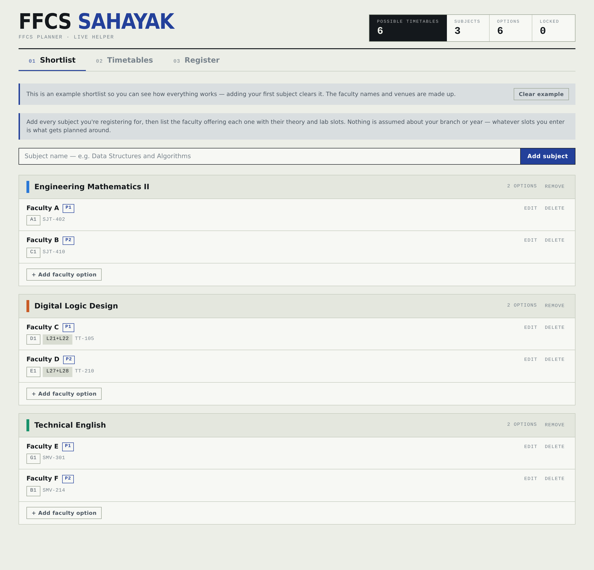
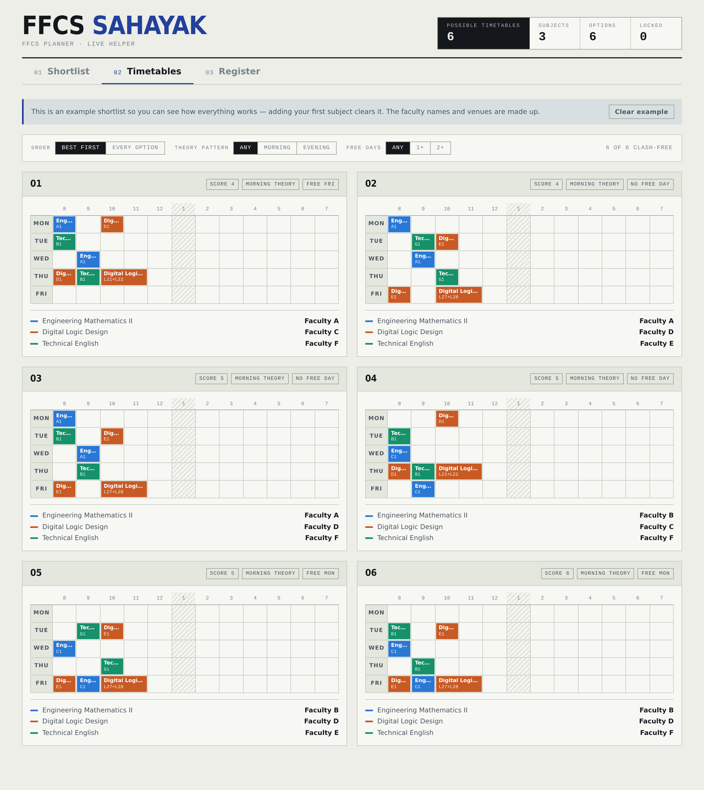
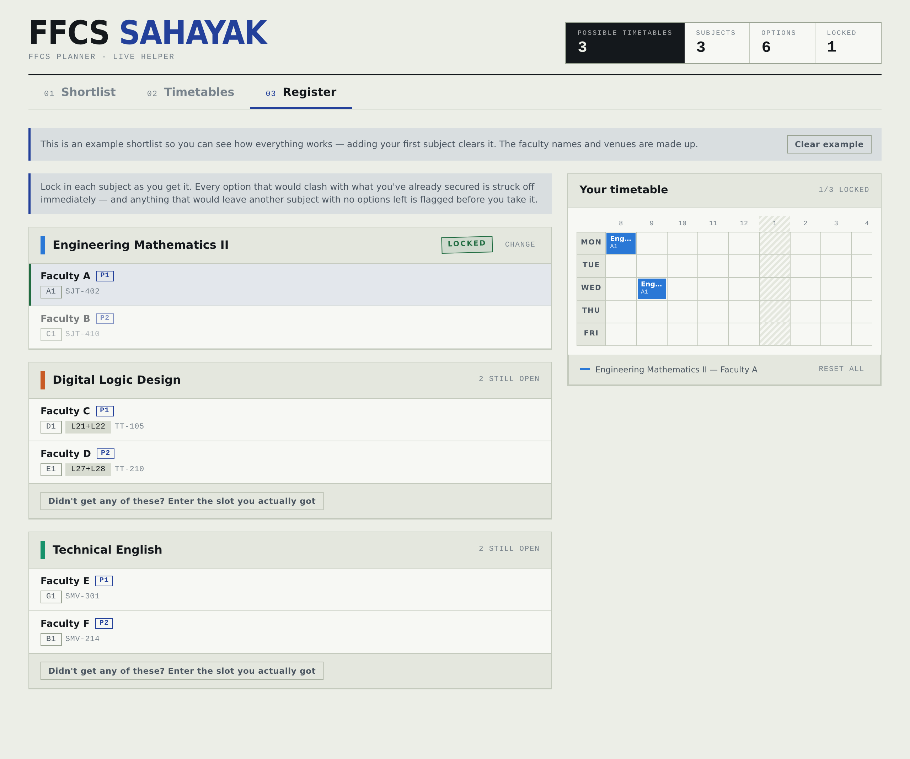

# FFCS Sahayak

A slot planner for VIT's FFCS course registration. You enter the subjects you're taking and the faculty offering each one, and it works out every clash-free timetable you could end up with — then helps you hold that plan together while seats disappear during live registration.

Works for any branch and any year. Nothing about departments, semesters, or morning/evening patterns is hardcoded; the app only knows VIT's slot grid and whatever slots you type in.



## Why

FFCS registration is a race. Seats go in seconds, and the plan you made the night before falls apart the moment someone else takes the faculty you wanted. Most people handle this with a spreadsheet and a lot of squinting at the slot grid, which is slow at exactly the moment you can't afford to be slow.

This does the squinting in advance.

## What it does

**Shortlist** — Add your subjects, then the faculty offering each one with their theory slots, lab slots, venue, and how much you'd prefer them. Slots can be typed as codes or picked by clicking the actual VIT timetable grid, which matters if you don't have the codes memorised. Because a theory slot meets twice a week, selecting one lights up both of its cells.

**Timetables** — Every clash-free combination of your shortlist, generated by backtracking over the slot grid. Ranked best-first by your preference ranks, with optional filters for morning/evening theory pattern and minimum free days. Filters, not constraints — a mixed pattern still shows up if that's what your options allow.



**Register** — The live one. Lock in each subject as you get it, and every faculty option that would clash with what you've secured is struck off immediately, with the reason. If you didn't get anyone on your list, record the slots you were actually allotted and the filtering carries on from there.



Two things that go beyond clash detection:

- A running count of how many complete timetables are still reachable, which drops as you lock choices in.
- **Dead-end warnings.** An option can be clash-free right now and still be a trap — taking it can leave another subject with zero surviving options. The app tests feasibility before you commit and names the subject that would get stranded.

## How the slot logic works

Each day is modelled as twelve one-hour periods, including the lunch hour that a 12–2 lab runs through. Every slot code maps to the `(day, period)` cells it occupies: a theory code to one cell per weekly meeting, a lab pair to two consecutive cells.

Two faculty options clash when their occupied cells intersect. That one rule covers theory-vs-theory, lab-vs-lab, and theory-vs-lab overlaps without any special cases, which is why nothing needs to know whether you're a morning-slot or evening-slot student.

Generating timetables is a backtracking search that picks one faculty per subject and prunes a branch the moment it overlaps what's already chosen. Feasibility checks reuse the same search with an early exit at the first solution, so the dead-end warnings stay fast enough to run on every render.

The slot grid itself lives in `src/data/timetable.js` as plain data. New or unusual slot codes can be added there without touching any logic.

## Running it

```bash
npm install
npm run dev
```

Build for production:

```bash
npm run build
```

There's also a single-file build that inlines all CSS and JS into one HTML file:

```bash
npx vite build --config vite.artifact.config.js
```

## Structure

```
src/
  data/timetable.js   VIT's slot grid as data + cell-occupancy helpers
  data/sample.js      example shortlist shown on first visit
  lib/clash.js        occupied-cell sets, clash checks
  lib/permute.js      backtracking generator, ranking, feasibility
  lib/analysis.js     pattern + free-day stats for the optional filters
  lib/grid.js         builds the weekly board from a set of choices
  components/         UI, one file per screen or reusable piece
  index.css           all visual design, driven by tokens
```

Styling is kept entirely separate from logic — the components reference class names and every colour, typeface, and spacing decision lives in `index.css`. The interface can be redesigned without touching the engine.

## Storage

Everything is saved in the browser's `localStorage`. Your shortlist survives closing the tab, but there's no account and no server, so it doesn't sync between devices and it's gone if you clear site data. A "Clear all" button (with a confirmation) wipes it deliberately.

## Tech

React 19, Vite, plain CSS. No UI framework, no backend, no dependencies beyond the build tooling.

## Disclaimer

Unofficial and student-built — not affiliated with, or endorsed by, VIT. Slot timings follow the published FFCS grid, but always confirm your final slots on the official portal before registering.

## License

MIT — see [LICENSE](LICENSE). Copyright © 2026 Sanvi Singh. You're welcome to read, fork and learn from the code; keep the copyright notice if you reuse it.

## Credits

Built by [Sanvi Singh](https://github.com/sanvixsingh). Slot grid transcribed from VIT's official FFCS timetable. Faculty names and venues in the example shortlist are made up.
